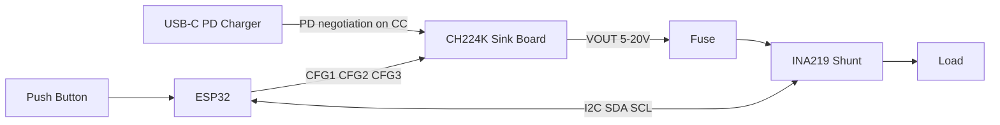

# USB-C PD Sink Controller: Build a Programmable 5V–20V Power Source with CH224K and ESP32

Ordinary USB-C chargers only give you 5V. Your 12V LED strip, 9V guitar pedal, or 20V laptop-class project won't run from that. The fix is a **USB-C Power Delivery (PD) sink controller**: a small chip that "asks" a PD charger for a higher voltage over the CC line.

In this guide you will build a **USB-C PD sink controller** using the **CH224K** trigger chip and an **ESP32**. A button cycles through **5V, 9V, 12V, 15V and 20V**, and an **INA219** sensor confirms the voltage the charger actually delivers. You get the wiring, a circuit diagram, tested-structure Arduino code, and a troubleshooting section for the problems people actually hit.

> **Safety first:** PD sources can deliver 20V at 3A or more. Check that your load can handle the voltage you select, and add a fuse on the output.

---

## Bill of Materials (BOM)

| Qty | Component | Specification / Notes | Where to Source |
|-----|-----------|-----------------------|-----------------|
| 1 | CH224K USB-C PD trigger breakout board | Must expose CFG1, CFG2, CFG3 pins and GND. Chip is a PD sink for 5/9/12/15/20V | Alibaba, AliExpress, local electronics suppliers [AFFILIATE_LINK] |
| 1 | ESP32 DevKit (30 or 38 pin) | 3.3V logic is **required**. CH224K CFG2/CFG3 must not exceed 3.7V | Alibaba, AliExpress, local suppliers [AFFILIATE_LINK] |
| 1 | INA219 breakout module | I2C current/voltage sensor, measures up to 26V bus and about 3.2A on default settings | Alibaba, AliExpress, local suppliers [AFFILIATE_LINK] |
| 1 | Push button (momentary) | Normally open | Any local supplier |
| 1 | 6.8 kΩ resistor | CFG1 to GND safe-default resistor | Any local supplier |
| 1 | USB-C PD charger | At least 20V-capable (45W or more) to test every profile | Phone or laptop charger |
| 1 | USB-C cable | Data/charging cable rated for 3A | Local supplier |
| 1 | Fuse holder + 2A fuse (recommended) | In series with the load positive | Local supplier |
| 1 | Breadboard + jumper wires | Dupont male-male | Local supplier |
| 1 | Test load | LED strip, 12V fan, or a resistor load rated for your target voltage | Your project |

**Buying tip:** Cheap trigger boards sometimes reorder or relabel the CFG pads. Always compare your board's silkscreen against the datasheet truth table below before wiring.

---

## CH224K Voltage Selection Table

Level configuration (from the WCH CH224K datasheet):

| CFG1 | CFG2 | CFG3 | Requested Voltage |
|------|------|------|-------------------|
| 1 | x | x | 5V |
| 0 | 0 | 0 | 9V |
| 0 | 0 | 1 | 12V |
| 0 | 1 | 1 | 15V |
| 0 | 1 | 0 | 20V |

`0` = driven to GND, `1` = driven high, `x` = don't care.

> **Important:** Other chips in the family (such as the CH224Q/CH224A) use a **different** truth table and add 28V. This guide is written for the **CH224K** only.

---

## Hardware Wiring Breakdown

| From (Board Pin) | To (Component Pin) | Function / Description |
|------------------|--------------------|------------------------|
| ESP32 GPIO25 | CH224K CFG1 | Voltage select bit 1 (also the 5V select) |
| ESP32 GPIO26 | CH224K CFG2 | Voltage select bit 2 |
| ESP32 GPIO27 | CH224K CFG3 | Voltage select bit 3 |
| CH224K CFG1 | 6.8 kΩ resistor to GND | Safe default (9V) before the ESP32 boots |
| ESP32 GPIO32 | Button pin A | Cycle voltage (internal pull-up used) |
| Button pin B | GND | Button return |
| ESP32 GPIO21 (SDA) | INA219 SDA | I2C data |
| ESP32 GPIO22 (SCL) | INA219 SCL | I2C clock |
| ESP32 3V3 | INA219 VCC | Sensor logic power (3.3V) |
| ESP32 GND | INA219 GND | Common ground |
| ESP32 GND | CH224K GND | **Common ground (required)** |
| CH224K VOUT+ | Fuse, then INA219 VIN+ | Power input to the sensor's shunt |
| INA219 VIN- | Load positive (+) | Power out to your load |
| CH224K GND | Load negative (-) | Return path |
| ESP32 GPIO33 (optional) | CH224K PG | Power Good flag. Only connect after confirming the PG voltage on your board is 3.3V-safe |

**Power note:** The ESP32 is powered through its **own USB port** (or a separate 5V source). Do not power it from the PD output, since that voltage changes.

---

## Schematic Wiring Diagram

### ASCII version

```text
 USB-C PD
 Charger ──cable──► [ CH224K BOARD ]
                     │ CC/VBUS in        CFG1 ◄──────────── GPIO25 ──┐
                     │                   CFG2 ◄──────────── GPIO26   │
                     │                   CFG3 ◄──────────── GPIO27   │   ┌─────────┐
                     │                    │                          ├───┤  ESP32  │
                     │                    └──[6.8k]──► GND           │   │ DevKit  │
                     │                                    GPIO32 ◄───┤   └────┬────┘
                     │                                    (button→GND)        │ I2C
                     │ VOUT+ ──[FUSE]──► VIN+ ┌─────────┐ VIN- ──► LOAD (+)   │
                     │                        │ INA219  │◄──── SDA/SCL ────────┘
                     │ GND ─────┬─────────────┤ GND     │
                                │             └─────────┘
                                ├──────────────────────────────► LOAD (-)
                                └──────────────────────────────► ESP32 GND
```

### Mermaid version



---

## Production-Ready Code (Arduino C++ for ESP32)

**Library required:** `Adafruit INA219` (Library Manager will also install `Adafruit BusIO`).

```cpp
/*
 * USB-C PD Sink Controller (CH224K + ESP32 + INA219)
 * Tech Circuit Guide - techcircuitguide.com
 * Author: Hakimu Maganda
 *
 * Press the button to cycle through 5V, 9V, 12V, 15V, 20V.
 * The INA219 reports the real voltage and current once per second.
 *
 * CH224K level truth table (datasheet):
 *   CFG1 CFG2 CFG3 -> Voltage
 *     1    x    x     5V
 *     0    0    0     9V
 *     0    0    1    12V
 *     0    1    1    15V
 *     0    1    0    20V
 */

#include <Wire.h>
#include <Adafruit_INA219.h>

// ---------------- Pin configuration ----------------
const uint8_t PIN_CFG1 = 25;
const uint8_t PIN_CFG2 = 26;
const uint8_t PIN_CFG3 = 27;
const uint8_t PIN_BTN  = 32;   // Button to GND (internal pull-up)
const uint8_t PIN_PG   = 33;   // Optional Power Good input

// ---------------- User settings --------------------
// Highest voltage you allow the button to select. Set to what your LOAD can take.
const uint8_t MAX_ALLOWED_VOLTAGE = 20;

// Set true only if PG is wired AND confirmed 3.3V-safe on your board.
const bool USE_PG = false;
// Check your board: PG polarity can differ between modules.
const bool PG_ACTIVE_LOW = true;

const unsigned long DEBOUNCE_MS = 50;
const unsigned long LOG_INTERVAL_MS = 1000;
const unsigned long RENEGOTIATE_DELAY_MS = 100;
const float VOLTAGE_TOLERANCE_V = 1.5;

// ---------------- Voltage profiles -----------------
struct Profile {
  const char* name;
  uint8_t voltage;
  uint8_t cfg1;
  uint8_t cfg2;
  uint8_t cfg3;
};

const Profile PROFILES[] = {
  {"5V",   5, 1, 0, 0},
  {"9V",   9, 0, 0, 0},
  {"12V", 12, 0, 0, 1},
  {"15V", 15, 0, 1, 1},
  {"20V", 20, 0, 1, 0}
};
const uint8_t PROFILE_COUNT = sizeof(PROFILES) / sizeof(PROFILES[0]);

// ---------------- State ----------------------------
Adafruit_INA219 ina219;
bool inaReady = false;
uint8_t currentIndex = 0;

bool lastButtonState = HIGH;
unsigned long lastDebounceTime = 0;
unsigned long lastLogTime = 0;

// Apply a profile. We "park" on 5V (CFG1 = 1) while changing CFG2/CFG3 so the
// chip never sees an unintended combination (for example 9V -> 15V passing
// through the 20V code) while the pins change one at a time.
void applyProfile(uint8_t index) {
  const Profile& p = PROFILES[index];

  digitalWrite(PIN_CFG1, HIGH);          // Park at 5V request
  delay(RENEGOTIATE_DELAY_MS);
  digitalWrite(PIN_CFG2, p.cfg2);
  digitalWrite(PIN_CFG3, p.cfg3);
  delay(RENEGOTIATE_DELAY_MS);
  digitalWrite(PIN_CFG1, p.cfg1);        // Final request

  currentIndex = index;
  Serial.printf("\n>> Requested profile: %s\n", p.name);
}

void nextProfile() {
  uint8_t candidate = currentIndex;
  for (uint8_t i = 0; i < PROFILE_COUNT; i++) {
    candidate = (candidate + 1) % PROFILE_COUNT;
    if (PROFILES[candidate].voltage <= MAX_ALLOWED_VOLTAGE) {
      applyProfile(candidate);
      return;
    }
  }
}

void handleButton() {
  bool reading = digitalRead(PIN_BTN);
  if (reading != lastButtonState && (millis() - lastDebounceTime) > DEBOUNCE_MS) {
    lastDebounceTime = millis();
    lastButtonState = reading;
    if (reading == LOW) {                // Falling edge = press
      nextProfile();
    }
  }
}

void logStatus() {
  if (!inaReady) {
    Serial.println("INA219 not found - voltage readout disabled.");
    return;
  }

  float busV = ina219.getBusVoltage_V();
  float currentMA = ina219.getCurrent_mA();
  float target = (float)PROFILES[currentIndex].voltage;

  Serial.printf("Target %s | Measured %.2f V | %.0f mA", PROFILES[currentIndex].name, busV, currentMA);

  if (USE_PG) {
    bool pgLevel = digitalRead(PIN_PG);
    bool good = PG_ACTIVE_LOW ? !pgLevel : pgLevel;
    Serial.printf(" | PG: %s", good ? "OK" : "NOT READY");
  }

  if (busV > 1.0 && (busV < target - VOLTAGE_TOLERANCE_V || busV > target + VOLTAGE_TOLERANCE_V)) {
    Serial.print(" | WARNING: voltage differs from target (charger may not offer this profile)");
  }
  Serial.println();
}

void setup() {
  Serial.begin(115200);
  delay(300);

  pinMode(PIN_CFG1, OUTPUT);
  pinMode(PIN_CFG2, OUTPUT);
  pinMode(PIN_CFG3, OUTPUT);
  pinMode(PIN_BTN, INPUT_PULLUP);
  if (USE_PG) {
    pinMode(PIN_PG, INPUT_PULLUP);
  }

  // Start at the safest profile: 5V.
  digitalWrite(PIN_CFG1, HIGH);
  digitalWrite(PIN_CFG2, LOW);
  digitalWrite(PIN_CFG3, LOW);

  Wire.begin(21, 22);
  inaReady = ina219.begin();
  if (!inaReady) {
    Serial.println("INA219 not detected. Check SDA/SCL wiring and address.");
  }

  Serial.println("USB-C PD Sink Controller ready. Press the button to change voltage.");
  applyProfile(0);
}

void loop() {
  handleButton();

  if (millis() - lastLogTime >= LOG_INTERVAL_MS) {
    lastLogTime = millis();
    logStatus();
  }
}
```

---

## Step-by-Step Implementation Guide

1. **Check your board.** Compare the CFG1/CFG2/CFG3 pads on your CH224K board against the datasheet. Some boards reorder them for layout reasons.
2. **Set up the Arduino IDE.** Install the ESP32 board package, then install **Adafruit INA219** from the Library Manager.
3. **Wire the control side first (no charger plugged in).** Connect GPIO25/26/27 to CFG1/2/3, the 6.8 kΩ resistor from CFG1 to GND, the button, and the I2C lines to the INA219. Join all grounds.
4. **Wire the power path.** CH224K VOUT+ → fuse → INA219 VIN+; INA219 VIN- → load +; CH224K GND → load -.
5. **Upload the code.** Select your ESP32 board and port, then upload. Open the Serial Monitor at **115200 baud**.
6. **Connect a test load.** Start with a light, safe load such as a 5V–12V LED strip or a resistor.
7. **Plug in the PD charger.** The Serial Monitor shows the target and measured voltage every second.
8. **Press the button to cycle.** Confirm each step with a multimeter at least once. Set `MAX_ALLOWED_VOLTAGE` to protect your load.
9. **Enclose and label.** Mount in a case and mark the voltage range clearly if others will use it.

---

## Troubleshooting & FAQs

### Compilation errors

**`fatal error: Adafruit_INA219.h: No such file or directory`**
Install "Adafruit INA219" via *Sketch → Include Library → Manage Libraries*. Install the BusIO dependency if prompted.

**`'Serial.printf' was not declared`**
You selected a non-ESP32 board. Choose an ESP32 DevKit under *Tools → Board*.

### Wiring and behavior problems

**Voltage is always 5V, even at the 20V profile.**
Check that your charger is a real PD charger (not just a basic 5V adapter), that the cable is a full USB-C cable, and that your board's CFG pads match the datasheet.

**Output is 20V right after power-up.**
If CFG1 floats before the MCU boots, the chip can request 20V. Keep the 6.8 kΩ resistor from CFG1 to GND so the default is 9V. If your load cannot tolerate 9V either, add a load switch that turns on only after the ESP32 starts.

**INA219 shows 0.00 V.**
Check VIN+/VIN- orientation, the common ground, and the I2C address. Run an I2C scanner sketch.

**The ESP32 resets when I change voltage.**
Power the ESP32 from its own USB port, not from the PD output, and keep the grounds common.

**The measured voltage is below the target.**
Your charger may not offer that profile (a 5V/9V/12V phone charger will not give 20V), or the cable drops voltage under load.

### Frequently Asked Questions

**Can I use an Arduino Uno instead of an ESP32?**
Not directly. The CH224K CFG2/CFG3 pins must not exceed 3.7V, and an Uno outputs 5V logic. Use a 3.3V board or level shifting.

**Does the CH224K support 28V or 100W?**
The CH224K tops out at 20V. For higher voltage, look at related chips such as the CH224Q/CH224A, which use a different truth table.

**Can I power a 12V device from a USB-C charger?**
Yes. Set the 12V profile (CFG1=0, CFG2=0, CFG3=1) with a charger that supports 12V or 20V PD output.

**Do I need a microcontroller at all?**
No. For a fixed voltage, a single resistor on CFG1 selects 9V (6.8 kΩ), 12V (24 kΩ), 15V (56 kΩ), or 20V (CFG1 not connected). The ESP32 adds runtime switching and monitoring.

**Is the measured voltage always exact?**
No. Treat the INA219 reading as a check, and verify once with a multimeter.

---

## Level Up Your Build

* **Where to buy the parts:** CH224K boards, ESP32 kits, and INA219 modules: [Buy on Amazon](https://www.amazon.com/dp/YOUR_PRODUCT_ID).
* **Recommended tools:** A basic USB-C PD tester and a bench multimeter make debugging much faster: [Buy on Amazon](https://www.amazon.com/dp/YOUR_PRODUCT_ID).
* **Download the files:** Get the wiring diagram PDF and sketch: [Download PDF and Sketch](https://techcircuitguide.com/downloads/usb-c-pd-sink-schematic.pdf).
- **Related guides on Tech Circuit Guide** (update these paths to your live URLs):
  - [ESP32 + INA219 Power Monitor Guide](/guides/esp32-ina219-power-monitor)
  - [Build a Fused Bench Power Supply from USB-C](/guides/usb-c-bench-power-supply)
  - [Choosing the Right Buck Converter for ESP32 Projects](/guides/buck-converter-esp32)
- **Stay updated:** Subscribe to the Tech Circuit Guide newsletter for new circuit builds each week.

*Disclosure: Some links above are affiliate links. If you buy through them, Tech Circuit Guide may earn a small commission at no extra cost to you.*
