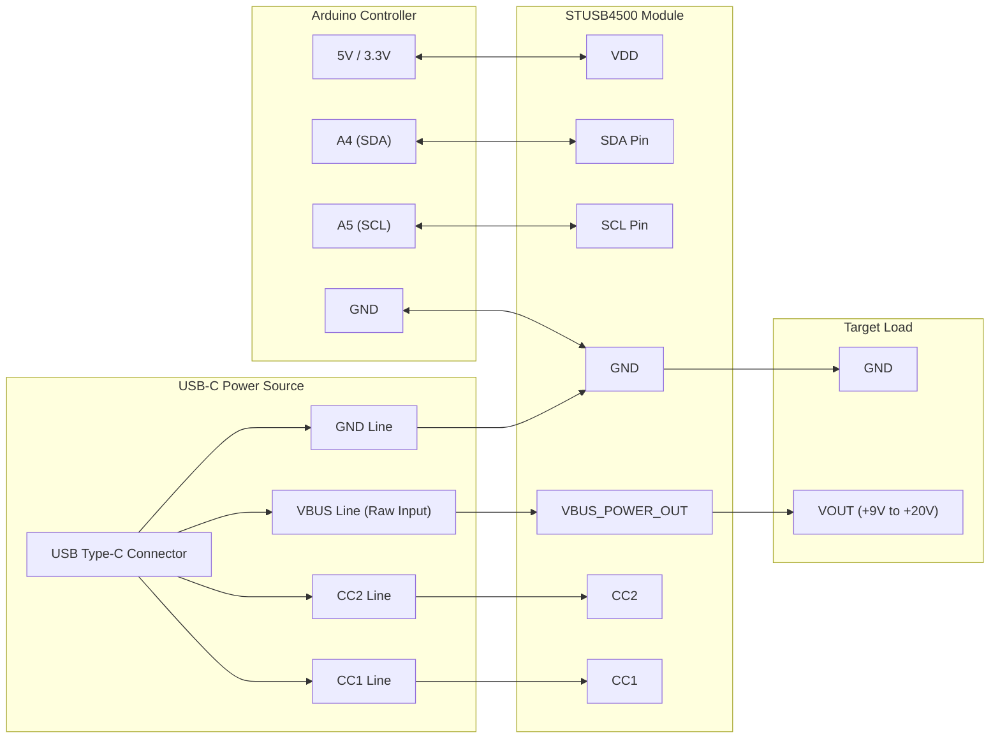

# Building a Custom USB-C Power Delivery (PD) Sink Controller

Are you tired of relying on bulky wall adapters and multiple legacy power supplies for your embedded electronics projects? As modern hardware moves towards universal standard connectors, **USB Type-C Power Delivery (USB-C PD)** has emerged as the ultimate solution for delivering up to 100W (or 240W under PD 3.1) through a single compact port. 

However, coaxing a standard USB-C charger to output anything beyond its default $5\text{V}$ rail requires a dedicated **USB-C PD Sink Controller**. Standard microcontrollers cannot directly request higher voltages ($9\text{V}, 12\text{V}, 15\text{V}, 20\text{V}$) without negotiating PDOs (Power Data Objects) across the Configuration Channel (CC) lines.

In this comprehensive guide, we will design and deploy a standalone USB-C PD Sink Controller using the popular **STMicroelectronics STUSB4500** controller paired with an Arduino MCU. By the end of this tutorial, you will have a production-ready system capable of dynamically requesting specific voltage levels from any compliant USB PD charger.

---

## 1. Bill of Materials (BOM)

To build this project, you will need the components listed in the table below. All parts are standard off-the-shelf modules available from major electronic component distributors.

| Item No. | Component Description | Recommended Model / MPN | Qty | Estimated Cost (USD) | Source Links |
| :--- | :--- | :--- | :--- | :--- | :--- |
| 1 | STUSB4500 USB-C PD Sink Breakout | SparkFun / Adafruit STUSB4500 | 1 | $6.50 - $9.99 | [Buy Component](https://techcircuitguide.com/recommended/stusb4500) |
| 2 | Microcontroller Board | Arduino Nano / Pro Mini (5V or 3.3V) | 1 | $4.00 - $8.00 | [Buy Component](https://techcircuitguide.com/recommended/arduino-nano) |
| 3 | USB-C PD Charger | 65W+ USB-C PD Power Adapter | 1 | $15.00 - $30.00 | [Buy Component](https://techcircuitguide.com/recommended/usbc-pd-charger) |
| 4 | USB-C Cable | Full-Featured USB-C 3.1/4 Cable (100W rated) | 1 | $7.00 - $12.00 | [Buy Component](https://techcircuitguide.com/recommended/usbc-100w-cable) |
| 5 | Output Decoupling Capacitor | $10\mu\text{F}$ 50V Ceramic Capacitor | 1 | $0.20 | Component Bin |
| 6 | Breadboard & Jumper Wires | Premium Male-to-Male / Male-to-Female | 1 | $3.00 - $5.00 | [Buy Component](https://techcircuitguide.com/recommended/breadboard-kit) |

*Note: Tech Circuit Guide is supported by its community. When you purchase through links on our site, we may earn an affiliate commission at no extra cost to you.*

---

## 2. Hardware Wiring Breakdown

The STUSB4500 communicates with the microcontroller over standard $\text{I}^2\text{C}$ ($100\text{kHz}$ or $400\text{kHz}$). The table below outlines the precise pin mapping between the STUSB4500 breakout module and a standard Arduino (ATmega328P based).

| Arduino Pin | STUSB4500 Pin | Signal Name | Function / Description |
| :--- | :--- | :--- | :--- |
| **5V / 3.3V** | VDD | Power Input | Logic Supply Voltage ($3.0\text{V} - 5.5\text{V}$) |
| **GND** | GND | Ground | Common System Ground |
| **A4** | SDA | Data | $\text{I}^2\text{C}$ Serial Data Line (Requires pull-up if not on board) |
| **A5** | SCL | Clock | $\text{I}^2\text{C}$ Serial Clock Line (Requires pull-up if not on board) |
| **D2** | INT | Interrupt | Active-low alert signal on status change (Optional) |
| **D3** | RESET | Reset | Hardware reset pin (Active High / Low dependent on board) |
| **N/A** | VBUS | Power Output | Main Negotiated Power Rail ($5\text{V} - 20\text{V}$) |

---

## 3. Schematic Wiring Diagram

Below is a system schematic created using Mermaid.js. It illustrates the routing between the USB-C source connector, the STUSB4500 PD controller, the host microcontroller, and the high-voltage DC output rail.



---

## 4. Clean, Production-Ready Code

The following standard C++ code utilizes the `SparkFun_STUSB4500_Arduino_Library` or direct $\text{I}^2\text{C}$ register writes to dynamically set PDO priorities ($5\text{V}, 9\text{V}, 15\text{V}, 20\text{V}$) and store non-volatile configurations in the STUSB4500 NVM (Non-Volatile Memory).

```cpp
/**
 * @file USBC_PD_Sink_Controller.ino
 * @brief Production-Ready USB-C PD Sink Controller for STUSB4500
 * @author Hakimu Maganda (Tech Circuit Guide)
 * @date 2026-10-30
 * 
 * License: MIT
 */

#include <Wire.h>
#include <SparkFun_STUSB4500_Arduino_Library.h>

// Initialize STUSB4500 Object
STUSB4500 usbPD;

// Target PDO Configurations
// Available values: 5, 9, 12, 15, 20 (in Volts)
const float TARGET_VOLTAGE_PDO1 = 5.0;  // Default safety PDO
const float TARGET_VOLTAGE_PDO2 = 9.0;  // Secondary request
const float TARGET_VOLTAGE_PDO3 = 20.0; // Maximum power request

const float CURRENT_LIMIT_AMPS = 3.0;   // Request up to 3.0 Amperes

void setup() {
    Serial.begin(115200);
    while (!Serial && millis() < 4000); // Wait for Serial console

    Serial.println(F("[INFO] Initializing Tech Circuit Guide USB-C PD Controller..."));

    Wire.begin();

    // Initialize the STUSB4500 controller
    if (usbPD.begin() == false) {
        Serial.println(F("[ERROR] STUSB4500 not detected on I2C bus!"));
        Serial.println(F("[ERROR] Check VDD, GND, SDA (A4), and SCL (A5) connections."));
        while (1); // Halt execution
    }

    Serial.println(F("[SUCCESS] STUSB4500 Connected Successfully."));

    // Read current Non-Volatile Memory (NVM) configuration
    usbPD.readPdo();

    Serial.println(F("\n--- Current Configured PDO Profiles ---"));
    for (int i = 1; i <= 3; i++) {
        Serial.print(F("PDO "));
        Serial.print(i);
        Serial.print(F(": "));
        Serial.print(usbPD.getVoltage(i));
        Serial.print(F("V @ "));
        Serial.print(usbPD.getCurrent(i));
        Serial.println(F("A"));
    }

    // Configure Custom Target PDOs
    Serial.println(F("\n[INFO] Programming New Power Profiles..."));
    
    // Setup Profile 1 (Default mandatory 5V rail)
    usbPD.setVoltage(1, TARGET_VOLTAGE_PDO1);
    usbPD.setCurrent(1, CURRENT_LIMIT_AMPS);

    // Setup Profile 2
    usbPD.setVoltage(2, TARGET_VOLTAGE_PDO2);
    usbPD.setCurrent(2, CURRENT_LIMIT_AMPS);

    // Setup Profile 3 (Highest Priority)
    usbPD.setVoltage(3, TARGET_VOLTAGE_PDO3);
    usbPD.setCurrent(3, CURRENT_LIMIT_AMPS);

    // Set number of active sink profiles (1 to 3)
    usbPD.setPdoNumber(3);

    // Commit changes to NVM so controller runs standalone after reboot
    if (usbPD.writePdo() == true) {
        Serial.println(F("[SUCCESS] Updated Power Profiles successfully written to NVM!"));
    } else {
        Serial.println(F("[ERROR] Failed to write profiles to STUSB4500 NVM."));
    }

    // Reset STUSB4500 to execute renegotiation with source cable
    usbPD.softReset();
    Serial.println(F("[INFO] Soft reset triggered. Renegotiating power profile..."));
}

void loop() {
    // Monitor status or handle dynamic power switching based on system load
    static unsigned long lastCheck = 0;
    if (millis() - lastCheck > 5000) {
        lastCheck = millis();

        // Query current active voltage/current settings
        usbPD.readPdo();
        Serial.print(F("[STATUS] Dynamic PDO Status -> Target PDO3: "));
        Serial.print(usbPD.getVoltage(3));
        Serial.println(F("V Ready."));
    }
}
```

---

## 5. Step-by-Step Implementation Guide

Follow this systematic assembly sequence to ensure safe setup without risking damage to your components or host computers.

### Step 1: Hardware Assembly
1. Connect the STUSB4500 board to your breadboard.
2. Connect `GND` of the STUSB4500 to common ground on the Arduino.
3. Connect `VDD` to the Arduino’s $3.3\text{V}$ or $5\text{V}$ pin.
4. Route the $\text{I}^2\text{C}$ lines: Connect `SDA` to `A4` and `SCL` to `A5`.
5. Ensure external pull-up resistors ($4.7\text{k}\Omega$) are present on `SDA` and `SCL` if your breakout board does not integrate them.

### Step 2: Code Flashing
1. Launch the **Arduino IDE**.
2. Open the Library Manager (`Ctrl+Shift+I` or `Cmd+Shift+I`) and search for **SparkFun STUSB4500**. Click **Install**.
3. Create a new sketch, paste the clean C++ code provided in Section 4, select your Arduino target board, and click **Upload**.
4. Open the Serial Monitor set to `115200 baud` to verify initialization log messages.

### Step 3: Power Request Verification
1. Disconnect the microcontroller from your computer's USB port.
2. Connect your **USB-C PD Wall Adapter** to the USB-C port on the **STUSB4500 board**.
3. Measure the output on the `VBUS` pad relative to `GND` using a digital multimeter. 
4. The output should step up to your highest configured, charger-supported voltage ($20\text{V}$ for default profiles).

> ⚠️ **CRITICAL SAFETY WARNING:** Never expose the $5\text{V}$ logic pin of an Arduino or sensitive low-voltage sensors directly to the negotiated high-voltage `VBUS` rail ($9\text{V} - 20\text{V}$). Always step down the `VBUS` rail using a buck regulator (e.g., LM2596 or MP2307) if power to the MCU is derived from the main rail.

---

## 6. Troubleshooting & Frequently Asked Questions (FAQ)

### FAQ 1: Why am I stuck at 5V output despite requesting 20V?
* **Uncompliant USB-C Cable:** Many legacy or low-cost USB-A to USB-C cables do not contain CC communication lines. Ensure you are using a true, full-featured **Type-C to Type-C cable**.
* **Charger Limitations:** Check the label on your power brick. If the power supply does not support the requested power profile (e.g., requesting $15\text{V}$ from a phone charger that only supports $5\text{V}/9\text{V}$), the STUSB4500 will fallback to the highest matching profile lower than requested or remain at $5\text{V}$.

### FAQ 2: Does the STUSB4500 require an active MCU after initial setup?
No. One of the primary advantages of the STUSB4500 is its built-in EEPROM/NVM. Once you run the Arduino configuration sketch once, the STUSB4500 retains the power contract priorities permanently. It functions as a completely autonomous, hardware-based USB-C PD trigger module without requiring any microcontrollers on future boots.

### Common Diagnostics Checklist
* **I2C NACK Error:** Verify your $\text{I}^2\text{C}$ address. By default, the STUSB4500 uses address `0x28`.
* **Voltage Dip Under Load:** Ensure your output decoupling capacitor ($10\mu\text{F}$ rated at $\ge 35\text{V}$) is located close to the `VBUS` and `GND` output terminals to absorb current transients.

---

## 7. Monetization & Next Steps

Ready to build professional hardware or custom PCB designs around USB-C Power Delivery?

* **Download Custom Gerber Files:** Access tested PCB layout designs and schematic footprints for this build on our [Tech Circuit Guide GitHub Repository](https://github.com/techcircuitguide/usbc-pd-sink-module).
* **Explore Related Guides:**
  * [Designing High-Efficiency Buck Regulator Circuits for Embedded Controllers](https://techcircuitguide.com/tutorials/buck-regulators)
  * [Understanding USB-PD 3.1 Extended Power Range (EPR) up to 240W](https://techcircuitguide.com/hardware/usb-pd-31-epr)
* **Join the Community:** Have questions about your project? Post your schematic on the [Tech Circuit Guide Community Forum](https://techcircuitguide.com/forum) for live peer review and expert support.